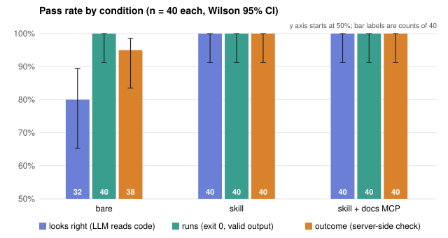
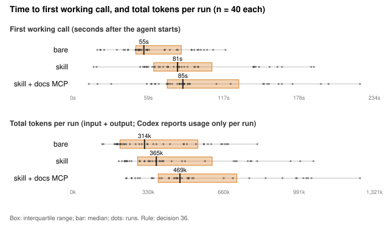

# AssemblyAI's skill, graded by what the API actually ran

**With AssemblyAI's skill, all 80 agent-built integrations did what the user asked, checked against what the API actually ran, and every one asked for a current model. Without the skill, 38 of 40 did what was asked, but only 12 of 40 asked for a current model (30%, 95% CI 18–45%).** Most of those runs still worked: in six, the server redirected a removed model, and the async tasks didn't depend on the model. Silent failures (the run is clean but the result is wrong) were 2 of 40 without the skill (5%, 1.4–16.5%) and 0 of 40 with it (0–8.8%), a difference not established at this n.

## Where agents without the skill go wrong

With the docs blocked, agents learn the API from the installed SDK (assemblyai 1.10.0). Its `SpeechModel` enum lists nine models, marks none as recommended, and still includes the removed `u3-rt-pro`. On the streaming task:

| Model requested (bare, 10 runs) | Model the server ran | Runs |
|---|---|---|
| `u3-rt-pro` (removed) | `universal-3-6-pro` (silent redirect) | 6 |
| `universal-streaming-english` | `universal-streaming-english` | 2 |
| `universal-3-6-pro` | `universal-3-6-pro` | 2 |

The two `universal-streaming-english` runs are the only silent failures. The request was valid, so there was no warning. The six redirected runs came out right only because of a redirect the skill documents (Phase 1 probe `stream.model.u3_rt_pro`).

On the async tasks, bare runs used `universal-2` (14 runs) or the superseded `universal-3-pro` (6 runs), which the API still accepts and applies. All 60 skill runs used `universal-3-5-pro`.

## What would close the remaining gap

1. **SDK:** mark the recommended model in `SpeechModel` and drop `u3-rt-pro`.
2. **Streaming API:** when it redirects `u3-rt-pro`, say so in `Begin`.
3. **Evals:** grade by execution as well as by reading code. The PR draft adds one.

## The API side (Phase 1)

51 known-wrong requests, each classified from the server's response ([rows](results/phase1/matrix.md)). Six were silently accepted:

| Class | async | streaming | sync | dictation | tts |
|---|---|---|---|---|---|
| instructive error | 5 | 3 | 1 | 4 | 4 |
| opaque error | 5 | 2 | 1 | 1 | 1 |
| silent accept | 1 | 5 | 0 | 0 | 0 |
| accepted with warning | 2 | 0 | 0 | 0 | 2 |
| accepted and applied | 3 | 3 | 2 | 1 | 1 |
| effect unverifiable | 1 | 0 | 2 | 1 | 0 |

## Three verdicts, speed and cost

A code-reading judge caught both silent failures and also failed the six redirected runs. Its assertion named the right model.

Skill runs reach their first working call later (median 55 s bare, 81 s skill, 85 s skill + MCP) and use more tokens. The skill buys correctness, not speed.

## Method

The agent was Codex CLI running `gpt-6.1-sol`, headless in Docker. Web search was off and AssemblyAI's docs hosts were blocked. There were four tasks (streaming clinic intake, async redaction, British spelling, legacy SDK upgrade), with 10 runs per task per condition.

- **`runs`:** `./run.sh` exited 0 and wrote valid output.
- **`outcome`:** a pre-registered check on server evidence (`GET /v2/transcript`, streaming `Begin.configuration`, SSN digits absent).
- **`looks_right`:** an LLM judge reads the code against written assertions, AssemblyAI's own method. Its two passes agreed on 120 of 120 runs, and a hand check of 20 runs found 0 wrong in 114 assertions.

For continuity, the same judge re-graded the skill repo's three committed with-skill outputs against today's `evals.json`: 14 of 18 assertions pass. Voice Standard Bench scores dictation the same way, mechanically against a known-correct output.

## Limitations

- One agent; the judge is the same model.
- Synthetic audio, n = 40 per condition.
- The streaming check reads frames the app logs.
- "Bare" is a no-docs baseline.
- Defined after seeing the data: the current-model measure (decision 38), the judge seeing T4's README (decision 37), and the first-call rule (decision 36).
